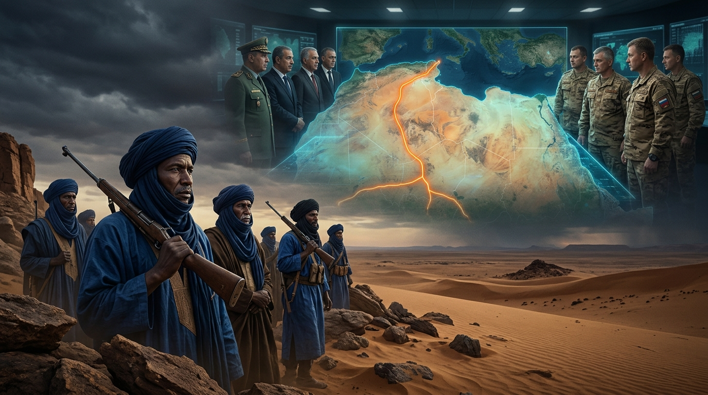

Par la rédaction d'Afrique Décrypte

La vulgate médiatique et diplomatique occidentale aime les fables confortables. Selon le narratif convenu martelé par les chancelleries et les agences de presse, la reprise de Kidal et l'écrasement des mouvements de l'Azawad dans le Nord-Mali résulteraient de la « montée en puissance des Forces Armées Maliennes (FAMA) », épaulées par la brutalité sans scrupules des mercenaires russes d'Africa Corps. Face à cela, la diplomatie algérienne aurait « déploré » la mort des accords d'Alger de 2015, impuissante devant l'arrogance des colonels putschistes de Bamako.

Cette grille de lecture n'est pas seulement naïve : c'est un contresens géopolitique total.

La vérité, que refusent d'admettre les thuriféraires du droit international et les humanitaires hors-sol, est infiniment plus clinique : **Kidal n'a pas été conquise militairement par Bamako ; Kidal a été vendue par Alger.**

En l'espace de quelques semaines, le régime algérien a opéré le plus spectaculaire retournement d'alliance de son histoire saharienne contemporaine. En lâchant sans sommation ses obligés touareg historiques, en fermant hermétiquement sa frontière nord pour les priver de sanctuaire et de ravitaillement, Alger a délibérément livré les rébellions nomades à l'artillerie et aux drones russes. 

Ce coup de poignard dans le dos n'est ni un coup de tête, ni une marque de faiblesse : c'est l'application glaciale de la réalpolitique la plus brute. Prise en étau entre l'ultimatum stratégique de Moscou et l'impératif existentiel de sauver son mégaprojet de gazoduc transsaharien (TSGP) face à l'offensive diplomatique du Maroc, la nomenklatura algérienne a sacrifié le peuple touareg sur l'autel de sa rente gazière.

    <figure>
        
        <figcaption>Octobre 2026 : Le sacrifice géopolitique de l'Azawad au profit de l'axe gazier et militaire Alger-Moscou-Bamako</figcaption>
    </figure>

---

### 1. 1963–2026 : La fin du double jeu cinquantenaire d'Alger

Pour saisir l'ampleur de ce séisme, il est impératif de remonter aux temps longs des fractures ethno-historiques du Sahara, analysées avec constance par Savinien de Montagnac. 

Depuis l'indépendance artificielle du Mali en 1960 — pur produit du découpage colonial français regroupant sous un même drapeau les populations sédentaires noires du Sud (Bambaras, Malinkés, Songhaïs) et les pasteurs nomades blancs du Nord (Touareg et Maures) —, le pouvoir de Bamako n'a jamais exercé la moindre souveraineté réelle sur l'Adrar des Ifoghas. Les révoltes touareg successives (1963, 1990, 2006, 2012) ont toujours buté sur la même réalité anthropologique : les hommes libres du désert refusent d'être assujettis à une bureaucratie mandingue située à 1 500 kilomètres au sud, le long du fleuve Niger.

Dans cette fracture séculaire, Alger avait érigé un système de rente géopolitique parfait. Se posant en « grand frère protecteur » et en arbitre incontournable du Sahara, l'Algérie hébergeait les états-majors rebelles touareg à Tamanrasset, soignait leurs blessés, finançait leurs chefs de factions (des Ifoghas féodaux de la famille d'Intalla aux chefs militaires du MNLA), tout en parrainant des accords de paix factices — dont les célèbres accords d'Alger de 2015 furent le monument de papier.

Ce dispositif servait trois objectifs vitaux pour le département du renseignement algérien (DRS, devenu DSS) :
1. **Sanctuariser son propre flanc sud** : En contrôlant les chefs touareg maliens, Alger empêchait toute contagion autonomiste parmi ses propres populations touareg du Hoggar et du Tassili.
2. **Empêcher l'émergence d'un État touareg indépendant** : Une république de l'Azawad souveraine aurait remis en cause les frontières héritées de la colonisation, dont l'Algérie a été la principale bénéficiaire territoriale aux dépens de ses voisins.
3. **Bloquer l'influence marocaine au Sahel** : Alger utilisait sa tutelle sur le septentrion malien comme un verrou géopolitique exclusif pour interdire toute projection politique ou économique de Rabat vers l'Afrique subsaharienne.

Mais ce savant équilibre reposait sur un prérequis fondamental : que Bamako demeure faible, divisée et dépendante de la médiation algérienne. Or, l'arrivée au pouvoir de la junte militaire d'Assimi Goïta, suivie de l'expulsion violente des forces françaises de Barkhane et de la MINUSMA, puis du déploiement massif de l'Africa Corps russe, a fait voler en éclats cette mécanique de parrainage feutré.

---

### 2. Le diktat de Moscou et l'impératif du gazoduc transsaharien (TSGP)

Le tournant décisif s'est joué à l'été 2026. Après la défaite cuisante infligée aux mercenaires russes et à l'armée malienne à Tin Zaouatine fin juillet 2024, le Kremlin a réajusté son dispositif de façon drastique. La victoire conjointe russo-malienne à Anéfis le 10 juillet 2026 a envoyé un signal sans équivoque à Alger : la Russie n'est pas venue au Sahel pour faire du maintien de la paix diplomatique, mais pour soumettre militairement l'espace sahélo-saharien et en chasser toute dissidence.

C'est à cet instant précis que Moscou a posé à Alger un ultimatum implacable : **choisir son camp**.

L'Algérie ne pouvait pas simultanément se prétendre l'alliée stratégique prioritaire de la Russie en Méditerranée — son principal fournisseur d'armes sophistiquées (avions Sukhoi, systèmes S-400, sous-marins Kilo) — et continuer à offrir un sanctuaire logistique et médical aux combattants du CSP-DPA (Cadre Stratégique Permanent) que les bataillons russes traquaient au sol. 

À cet ultimatum militaire s'est greffée une angoisse économique existentielle pour le pouvoir algérien : **la bataille des gazoducs transsahariens**.

Le régime d'Alger, archétype de l'État rentier décrit par l'École autrichienne, vit exclusivement de la captation et de la redistribution de la manne hydrocarbure par la compagnie étatique Sonatrach. Or, avec l'épuisement progressif de ses gisements matures et la flambée de sa consommation intérieure, l'Algérie doit désespérément trouver de nouvelles sources d'approvisionnement pour honorer ses contrats de livraison vers l'Europe méridionale (Italie, Espagne) et préserver sa rente géopolitique.

Son projet fétiche ? Le **TSGP (Trans-Saharan Gas Pipeline)**, ou gazoduc transsaharien : un serpent de mer gazier de 4 128 kilomètres destiné à acheminer plus de 30 milliards de mètres cubes de gaz par an depuis le delta du Niger au Nigéria, à travers tout le territoire du Niger, jusqu'aux terminaux gaziers algériens de Hassi R'Mel.

Problème majeur pour Alger : ce mégaprojet d'État est menacé de mort par son rival direct, le gazoduc offshore **Nigéria-Maroc (NMGP)**, vigoureusement promu par Mohammed VI, qui contourne le piège sahélien par les côtes d'Afrique de l'Ouest pour rallier l'Europe via le détroit de Gibraltar.

Pour sauver le TSGP et convaincre Abuja de ne pas basculer définitivement dans le projet marocain, Alger avait un besoin absolu de stabiliser son flanc nigérien et d'obtenir la coopération totale de la junte militaire de Niamey (le général Tiani), elle-même étroitement liée aux juntes de Bamako et de Ouagadougou au sein de l'Alliance des États du Sahel (AES).

La démonstration est arithmétique :
- Sans entente avec la junte de Niamey et ses parrains russes, le tracé du gazoduc TSGP à travers le Niger est rigoureusement impossible.
- Or, Niamey et Bamako conditionnaient toute coopération économique et sécuritaire avec Alger à une exigence non négociable : **l'abandon total des rebelles touareg et la coupure de leurs bases arrières en territoire algérien**.

Face au risque de perdre le marché gazier européen au profit du Maroc et de se brouiller avec son protecteur militaire russe, Alger n'a pas hésité une seconde. Le choix de la rente a balayé soixante ans de rhétorique tiers-mondiste.

Dès le mois d'août 2026, Alger et Bamako annonçaient opportunément vouloir « tourner la page des tensions » et scellaient une normalisation sécuritaire complète. Fin août et début septembre 2026, l'armée algérienne allait même jusqu'à apporter un soutien opérationnel direct à la junte nigérienne pour mater une tentative de coup d'État. Le sort des Touareg était scellé : abandonnés par leur parrain historique, privés de munitions et de carburant, les maquis de Kidal n'avaient plus qu'à plier.

---

### 3. L'illusion constructiviste d'un pipeline à travers la guerre ethnique

L'analyse de cette capitulation algérienne sous le prisme de l'École autrichienne (Bastiat, Hayek, Mises) met en lumière une tragique erreur d'ingénierie constructiviste.

Les planificateurs centraux d'Alger et de Bamako partagent la même croyance technocratique délirante : ils s'imaginent qu'un tracé sur une carte d'état-major et quelques signatures de décrets ministériels suffisent à abolir les réalités humaines et économiques du terrain. Frédéric Bastiat décrivait avec précision cette dérive où la « spoliation légale » se drape dans les oripeaux de la « raison d'État » pour écraser les droits de propriété des individus.

Le Sahara n'est pas un espace vide voué à servir de tuyauterie pour des oligarchies étatiques prédatrices. C'est un maillage complexe d'ordres spontanés millénaires : des routes de transhumance pastorale, des réseaux commerciaux caravaniers informels, des équilibres coutumiers entre tribus suzeraines et tributaires. 

En pensant pouvoir sécuriser un corridor gazier de 4 000 kilomètres en massacrant les pasteurs nomades et en confiant la garde des sables à des mercenaires russes étrangers à la langue, au climat et aux codes locaux, Alger et les juntes de l'AES commettent une erreur d'appréciation mortelle. 

Comme l'enseignait Ludwig von Mises, toute intervention coercitive violente de l'État contre les structures spontanées du marché détruit les signaux économiques et crée des désordres infiniment plus graves que ceux qu'elle prétendait résoudre :
- La fermeture brutale de la frontière et le blocus du commerce transfrontalier informel affament les populations locales, anéantissant l'économie productive marchande au seul bénéfice des réseaux de contrebande lourdement armés et du djihadisme résiduel (JNIM).
- Un gazoduc enterré dans le désert constitue une cible tactique d'une vulnérabilité absolue. Il ne faut que quelques kilogrammes d'explosifs et une moto pour sectionner une conduite sous pression au milieu du Ténéré ou du Sahara central. 
- Comment Alger espère-t-elle sécuriser des milliers de kilomètres de tuyaux d'acier dans un environnement où elle vient de transformer chaque clan touareg en ennemi juré, désireux de venger l'affront de la trahison ?

La foi aveugle des régimes prédateurs dans la force brute n'a jamais produit d'ordre économique stable. Elle ne produit que la ruine et l'insécurité permanente.

---

### 4. Le piège se referme sur Alger : la revanche des temps longs

En croyant réaliser un coup de maître diplomatique en troquant Kidal contre l'amitié de Moscou et le corridor nigérien, le régime algérien s'est en réalité tiré une balle dans le pied.

Pendant des décennies, le sanctuaire touareg malien servait de fusible protecteur à l'Algérie. Les Touareg du Mali, tout absorbés par leur lutte existentielle contre Bamako, constituaient un écran tampon absorbant les chocs du Sahel. 

En détruisant ce tampon pour complaire à la junte d'Assimi Goïta, Alger a fait sauter son propre verrou de sécurité :
1. **L'Africa Corps est désormais à sa frontière directe** : Les paramilitaires russes ne sont pas des philanthropes au service des intérêts d'Alger. Moscou détient désormais le contrôle opérationnel direct de la frontière sud algérienne, privant Alger de son statut historique d'arbitre régional et transformant le pouvoir algérien en débiteur stratégique du Kremlin.
2. **Le poison de la rancœur identitaire** : La trahison d'Alger est vécue par l'ensemble des tribus touareg — du Mali, du Niger, mais aussi du Sud algérien — comme une félonie impardonnable. Les liens de sang transfrontaliers sont indifférents aux postes de douane. Les chefs de tribus du Hoggar et du Tassili observent avec dégoût la manière dont leurs cousins de Kidal ont été livrés aux milices sudistes et aux exactions de l'armée de Bamako. La fracture ethno-politique interne à l'Algérie, jadis étouffée par la corruption des subventions publiques, vient d'être réactivée avec une violence sourde.
3. **Le triomphe silencieux du Maroc** : En démontrant aux yeux de tout le continent qu'elle est un partenaire imprévisible, capable de sacrifier ses alliés historiques en 24 heures pour un baril de brut ou un mètre cube de gaz, l'Algérie s'est isolée diplomatiquement. Pendant ce temps, le Maroc tisse patiemment sa toile à travers son Initiative Royale pour l'Atlantique, offrant aux pays du Sahel (Mali, Niger, Burkina, Tchad) un débouché maritime garanti et des investissements marchands solides, fondés sur des flux commerciaux réels et non sur des oukases militaires.

---

### Conclusion : La faillite des marchands d'illusions

L'épisode de la reddition de Kidal et du revirement algérien d'octobre 2026 restera dans les annales comme l'illustration suprême de la faillite du constructivisme géopolitique postcolonial.

En croyant pouvoir substituer le cynisme d'un deal gazier et mercenaire aux réalités anthropologiques pluriséculaires du Sahara, Alger a cru gagner du temps. Elle a en réalité scellé son propre déclassement. 

Les guerriers de l'Azawad ont déposé leurs drapeaux à Kidal, mais ils n'ont pas disparu. Ils se sont fondus dans le désert, emportant avec eux une haine recuite contre la trahison d'Alger et la certitude que leur survie ne dépendra plus jamais d'aucun traité diplomatique.

La junte de Bamako peut bien parader dans les rues de Kidal sous la protection des fusils russes ; le gazoduc transsaharien peut bien continuer d'orner les plaquettes publicitaires des ministères d'Alger. Dans les sables du Sahara, ce ne sont ni les communiqués de Sonatrach ni les mercenaires de passage qui ont le dernier mot. 

C'est toujours l'histoire, la géographie et les peuples réels qui finissent par présenter l'addition. Et pour Alger, la facture s'annonce exorbitante.
