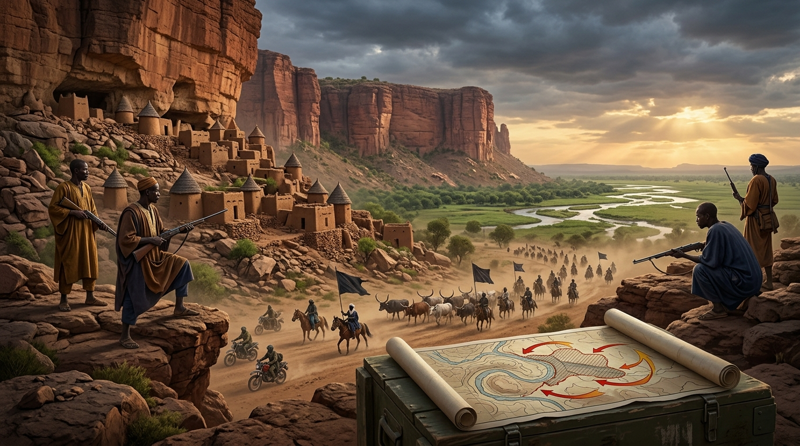

Par la rédaction d'Afrique Décrypte

Depuis plus d'une décennie, les rapports d'experts onusiens, les ONG humanitaires et les chancelleries occidentales récitent d'une seule voix le même catéchisme lénifiant sur l'embrasement du centre du Mali. Selon cette fable convenue, les cultivateurs Dogon du plateau de Bandiagara et les éleveurs Peul du delta intérieur du Niger auraient vécu « traditionnellement en parfaite harmonie » pendant des siècles, avant que leur idylle pastorale ne soit soudainement brisée par l'irruption d'un « extrémisme violent » importé et par les effets du « dérèglement climatique mondial ».

En face, la junte militaire sudiste de Bamako et ses supplétifs russes d'Africa Corps partagent paradoxalement le même aveuglement : en qualifiant indistinctement de « terroristes » l'ensemble des maquis de la région de Mopti et de Ségou, ils s'imaginent pouvoir régler par le napalm, les drones et les colonnes blindées une question qui plonge ses racines au plus profond de l'histoire précoloniale ouest-africaine.

Ce double narratif — l'angélisme sociologique occidental d'un côté, le jacobinisme sécuritaire de Bamako de l'autre — relève de la supercherie intellectuelle.

Dans la boucle du Niger, l'islamisme n'est pas la cause première de la guerre : il est la **surinfection idéologique d'une plaie ethno-territoriale et économique séculaire**. Ce qui se joue du Macina jusqu'aux escarpements de Bandiagara n'est rien d'autre que la reprise d'un affrontement existentiel entre deux civilisations irréductibles — les maîtres de la houe et les maîtres de la vache —, un conflit mis sous cloche pendant soixante-sept ans par la colonisation française et rallumé par la faillite de l'État prédateur postcolonial.

Savinien de Montagnac livre ici l'autopsie historique, anthropologique et économique de la poudrière du Mali central.

    <figure>
        
        <figcaption>Novembre 2026 : Du bastion rocheux de Bandiagara aux pâturages du Macina — L'affrontement séculaire entre sédentaires Dogon et pasteurs Peul sous le vernis de la guerre antiterroriste</figcaption>
    </figure>

---

### 1. Bandiagara et la Dina du Macina : Le Sang des Temps Longs contre l'Amnésie des Sociologues

Pour mesurer l'inanité des théories de « l'école historique de la culpabilité européenne » — dont les figures de proue au CNRS et à l'EHESS, de Jean-Pierre Chrétien à Jean-Loup Amselle ou Catherine Coquery-Vidrovitch, ont osé soutenir pendant quarante ans que les ethnies africaines étaient des « créations artificielles de l'administration coloniale » —, il suffit de contempler la géographie physique du pays dogon.

Pourquoi les Dogon se sont-ils fixés dans l'environnement austère et minéral du plateau et de la falaise de Bandiagara, une muraille de grès abrupte haute de 300 à 600 mètres surplombant les plaines du Séno-Gondo ?

Ce n'est nullement par caprice esthétique ou par goût du pittoresque. L'installation des Dogon dans les éboulis rocheux et les anciennes cavernes troglodytes des Tellem est l'aboutissement d'une **longue fuite devant un ennemi à cheval : les chasseurs d'esclaves musulmans, majoritairement peul**. Le Coran interdisant théoriquement la réduction en servitude des croyants, les Dogon, demeurés farouchement fidèles à leur culture animiste, constituèrent pendant des siècles le gibier de prédilection des razzias esclavagistes. La falaise de Bandiagara, invisible depuis la plaine, pourvue de sources dans ses failles et de grottes permettant de stocker le mil, fut leur citadelle de survie.

Au XIXe siècle, avant l'arrivée des troupes françaises, l'Ouest africain sahélien fut mis à feu et à sang par trois grands jihads peul :
1. **Le jihad d'Ousmane dan Fodio (1804)** en pays Haoussa (actuel nord du Nigeria et Niger) ;
2. **Le jihad de Sékou Amadou (1818)** dans le Macina : profitant de l'affaiblissement du royaume bambara animiste de Ségou après la mort du roi Monzon (1808) — qui servait jusque-là de rempart aux populations païennes —, Sékou Amadou s'empare de Djenné en 1819, soumet Tombouctou et fonde l'empire théocratique peul du Macina (la *Dina*), étendant son emprise jusqu'à la confluence du Sourou et de la Volta Noire ;
3. **Le jihad d'El Hadj Omar Tall (1852-1864)** : le conquérant toucouleur écrase les royaumes bambara du Kaarta et de Ségou (1861), renverse ses propres coreligionnaires peul du Macina en 1862, avant de périr en 1864 au cœur même des plateaux de Bandiagara face à la révolte acharnée du pays.

Dans cette tourmente, les Dogon ne durent leur survie physique qu'à leur retranchement vertical. Mais ils y perdirent la quasi-totalité de l'accès au piémont agricole fertile, transformé par l'aristocratie militaire et pastorale peul en domaine exclusif de pacage et en réserve de captifs (*Rimaïbé*).

Or, en Afrique de l'Ouest, cette histoire du XIXe siècle n'est pas une curiosité d'archives : elle est la matrice brûlante du présent. Pour la mémoire collective peul, Sékou Amadou et El Hadj Omar demeurent les héros de l'âge d'or pastoral et islamique. Pour la mémoire collective dogon et bambara, ils sont l'incarnation d'un impérialisme prédateur et esclavagiste qui a spolié leurs terres et vendu leurs aïeux.

Lorsque le général français **Louis Archinard** conquiert la région en **1893**, la colonisation produit un renversement géopolitique total :
- Pour les peuples sédentaires (Dogon, Bambara, Djerma), l'arrivée des Français est vécue comme une **délivrance historique** qui brise le monopole militaire de la cavalerie peul et met fin aux razzias d'esclaves.
- Protégés par la paix coloniale, les cultivateurs dogon redescendent progressivement de leur falaise pour défricher et coloniser les terres basses de la plaine dont ils avaient été chassés un siècle plus tôt.
- Inversement, les pasteurs peul voient avec amertume ces paysans sédentaires s'emparer de ce qu'ils considéraient, par droit de conquête, comme leurs pâturages. Après les indépendances de 1960, le suffrage universel et l'« ethno-mathématique électorale » achèvent d'inverser la pyramide précoloniale : le pouvoir d'État à Bamako passe intégralement aux mains des ethnies sédentaires majoritaires du Sud, reléguant les Peul à la marginalité politique.

---

### 2. « Yengulu a tué son Peul » : L'Antagonisme Cosmologique que le Jihadisme d'Amadou Koufa a Réveillé

Croire qu'un tel contentieux puisse s'évaporer dans les vapeurs d'un atelier onusien de « cohésion sociale », c'est ignorer la profondeur anthropologique qui sépare les deux peuples.

Comme l'avait magistralement théorisé l'officier-savant et géographe **Yves Urvoy** dans son *Histoire de l'empire du Bornou* (1949) et son *Petit atlas ethno-démographique du Soudan* (1942), toute l'histoire de la bande sahélo-soudanienne est rythmée par cette friction permanente entre le pasteur mobile, mû par le mépris des frontières bornées, et le paysan sédentaire, enraciné dans la glèbe sacrée de ses ancêtres.

En pays dogon, l'hostilité envers le Peul n'est pas seulement économique ; elle est inscrite au cœur même du rituel religieux et funéraire. Les travaux ethnographiques de référence de Mirjam de Bruijn, Rijk van Dijk et Walter van Beek (*Antagonisme et solidarité : les relations entre Peuls et Dogons du Mali*, 1997) ont documenté une réalité que la bien-pensance académique préfère taire : lors des funérailles de chaque vieillard dogon, la communauté récite solennellement le mythe de **Yengulu**. Dans ce texte liturgique, le défunt est célébré pour avoir accompli sa destinée d'homme et de cultivateur en abattant de son fusil un pasteur peul armé d'une lance au pied de la falaise, avant de rapporter sa tête au village avec cette injonction collective : *« Demain, quand tu repars en brousse, si tu vois un Peul, tue-le ! »* La cérémonie s'achève par l'incendie rituel d'une paillote miniature figurant l'habitat peul au centre de la place publique, suivi du sacrifice à coups de lances d'un chien baptisé *« Pullo »* (le Peul), dont la dépouille est jetée de nuit dans la brousse pastorale.

C'est sur ce volcan anthropologique que le prédicateur radical peul **Amadou Koufa** a jeté une allumette en 2015 en fondant la **Katiba Macina** (intégrée au JNIM d'Iyad Ag Ghali).

En habillant la frustration territoriale et sociale des pasteurs peul sous le drapeau noir du salafisme armé, Amadou Koufa n'a pas importé un concept étranger : il a explicitement proclamé la **restauration de la Dina de Sékou Amadou**. Pour des milliers de jeunes bergers peul, s'enrôler dans la Katiba Macina ne relevait pas d'une spéculation théologique sur le califat mondial, mais d'une revanche armée concrète pour :
1. Chasser des plaines et des pâturages les cultivateurs dogon et bambara ;
2. S'affranchir de la tutelle de l'administration sudiste de Bamako ;
3. Briser au passage la domination interne de leurs propres élites coutumières féodales (*Ardubé* et *Moodibabé*) au profit des castes pastorales subalternes et des anciens captifs.

La réponse dogon fut d'une symétrie implacable : la création des milices de chasseurs traditionnels (*Donzo*), structurées autour de **Dan Na Ambassagou** (« les chasseurs qui se confient à Dieu »). Derrière l'étiquette moderne de « lutte contre le terrorisme », la falaise de Bandiagara et la plaine du Séno ont aussitôt renoué avec la guerre totale du XIXe siècle : villages encerclés, greniers à mil incendiés, troupeaux de zébus abattus ou razziés, massacres communautaires d'Ogossagou et de Sobane Da.

---

### 3. Autopsie de l'École Autrichienne : La « Rapacité de la Houe », la Tragédie des Communaux et la Spoliation Étatique

Si l'ethno-histoire explique la ligne de fracture, seule la grille de lecture de **l'École autrichienne d'économie** (Ludwig von Mises, Friedrich Hayek, Frédéric Bastiat) et de **l'Objectivisme d'Ayn Rand** permet de comprendre pourquoi cette tension séculaire a dégénéré en effondrement économique systémique au XXIe siècle.

Pendant des siècles, en dépit de leur hostilité viscérale, pasteurs peul et cultivateurs dogon avaient développé par la pratique ce que Friedrich Hayek appelle un **ordre spontané catallactique** : un faisceau de conventions coutumières informelles régulant l'usage alterné de l'espace. Après la récolte du mil par les sédentaires, les troupeaux peul entraient sur les chaumes en novembre lors de la décrue du Niger, nourrissant leur bétail tout en fumant gratuitement les champs des paysans et en échangeant lait et viande contre céréales.

Trois chocs matériels, aggravés de manière criminelle par l'interventionnisme constructiviste de l'État malien, ont détruit cet équilibre spontané :

#### 1. L'explosion démographique et la « rapacité de la houe »
En un demi-siècle, sous l'effet d'une croissance démographique non maîtrisée, les surfaces cultivées en Afrique de l'Ouest sahélienne ont bondi de plus de **50 %**. Les agriculteurs dogon ont abandonné les jachères trisannuelles, abattu les boisements de tamaris pour alimenter les fours à pain urbains et défriché systématiquement les **couloirs de transhumance (*burtol*)** ainsi que les abords des points d'eau. Simultanément, les paysans sédentaires ont eux-mêmes capitalisé leurs surplus dans le bétail, entrant en compétition frontale avec les Peul pour les mêmes herbages. Comme les Tutsi des collines des Grands Lacs, le pasteur peul s'est retrouvé acculé à se battre pour *« sauvegarder les biens de la vache contre la rapacité de la houe »*.

#### 2. La nationalisation foncière et la destruction des droits de propriété
Face à cette raréfaction de la ressource foncière, quelle fut la réponse de l'État postcolonial malien et des bailleurs de fonds internationaux (Banque mondiale, FMI, Agence française de développement) ? L'étatisation constructiviste. En prétendant substituer des codes domaniaux bureaucratiques aux droits d'usage coutumiers (comme les règles ancestrales de préséance des *Jowro* peul sur les *bourgoutières*, ces riches pâturages inondables du delta intérieur du Niger), l'État central a créé une **tragédie des communaux** doublée d'une machine à corruption.

Privés de titres de propriété privés clairs, opposables et librement négociables, paysans dogon et éleveurs peul sont devenus les otages d'une administration prédatrice :
- Le préfet, le juge, le gendarme et l'agent des Eaux et Forêts envoyés depuis Bamako ne arbitrent jamais un litige foncier selon le droit : ils vendent leur décision au plus offrant.
- Lorsqu'un troupeau peul empiète sur un champ dogon planté au milieu d'un ancien couloir de transhumance, le berger est racketté par la gendarmerie à coups d'amendes confiscatoires ; lorsque le paysan dogon réclame justice, le chef peul fortuné achète le magistrat.
- Plus absurde encore : au nom d'un écologisme technocratique importé des capitales européennes, les États sahéliens et côtiers ont sanctuarisé d'immenses « réserves naturelles » (notamment à la frontière du Burkina Faso, du Niger et du Bénin), expulsant par la force les éleveurs de leurs parcours séculaires.

#### 3. Le racket croisé des parasites contre les producteurs réels (Ayn Rand / Bastiat)
C'est précisément dans cette brèche ouverte par la **spoliation légale** de l'État que les groupes jihadistes ont bâti leur modèle économique.

Appliquons la praxéologie de Mises aux incitations réelles du berger peul dans le Macina ou le Gourma :
- D'un côté, l'agent forestier de l'État lui extorque des centaines de milliers de francs CFA pour avoir fait paître ses zébus dans une zone classée, tandis que les milices soutenues par l'armée menacent son campement.
- De l'autre, les commandants de la Katiba Macina chassent les gardes forestiers, rouvrent gratuitement les réserves naturelles au pâturage, exécutent les voleurs de bétail et substituent aux bakchichs imprévisibles des fonctionnaires une taxe islamique fixe (*la zakat*, prélevée à hauteur d'une tête de bétail sur trente ou quarante).

La démonstration est glaciale : **ce n'est pas le fanatisme religieux qui a jeté une fraction des pasteurs peul dans les bras du jihadisme, c'est la faillite et la prédation de l'État central**.

Mais comme toujours dans les régimes de coercition, le remède prétorien s'avère aussi destructeur que le mal. Aujourd'hui, le véritable producteur du Mali central — l'agriculteur dogon qui cultive ses oignons et son mil sur le plateau, l'éleveur peul qui conduit son cheptel vers les marchés de Mopti ou de Bamako, le commerçant bozo qui transporte le poisson séché sur le fleuve — est broyé entre deux appareils parasites :

| Mécanisme de Prédation Économique | Spoliation Étatique & Milicienne (Bamako / Africa Corps) | Spoliation Insurrectionnelle (Katiba Macina / JNIM) | Impact sur l'Économie Réelle (École Autrichienne) |
| :--- | :--- | :--- | :--- |
| **Fiscalité & Extorsion** | Amendes forestières arbitraires, racket aux check-points militaires, réquisitions pour l'effort de guerre. | Prélèvement forcé de la *zakat* sur les troupeaux (1 zébu sur 30/40) et dîme sur les récoltes de mil. | Érosion massive du capital productif et fuite des grands troupeaux hors du circuit économique malien. |
| **Circulation & Marchés** | Interdiction des motos, bombardement et fermeture de dizaines de foires hebdomadaires rurales accusées de « ravitailler l'ennemi ». | Blocus et sièges des villages dogon réfractaires, embuscades sur les axes routiers RN6 et RN15. | Destruction de la division du travail : effondrement des échanges lait/viande contre céréales, flambée des prix alimentaires. |
| **Droits Fonciers** | Nationalisation bureaucratique des terres, marchandisation corrompue des arbitrages judiciaires sur les *bourgoutières*. | Confiscation violente des terres agricoles des villages déplacés et redistribution clientéliste des pâturages. | Insécurité juridique absolue, arrêt des investissements agricoles et prolétarisation des jeunes bergers sans bétail. |

---

### 4. La Chute Stratégique : L'Onde de Choc des 40 Millions de Peul vers le Golfe de Guinée

L'aveuglement de la junte d'Assimi Goïta et de ses conseillers russes d'Africa Corps dans le centre du Mali prépare une déflagration qui dépasse de très loin la seule falaise de Bandiagara.

En traitant le problème du Macina et du Gourma par la terre brûlée, en assimilant chaque campement peul à une base terroriste et en laissant prospérer les représailles ethniques, Bamako commet une erreur stratégique monumentale.

Contrairement aux Touareg du Nord, qui constituent une minorité démographique cantonnée aux immensités désertiques sahariennes, **les Peul forment un peuple sans État de plus de 40 millions d'âmes dispersé à travers quinze pays d'Afrique de l'Ouest et centrale**, de l'Atlantique sénégalais jusqu'au bassin du lac Tchad et à la Centrafrique.

En détruisant l'économie pastorale du delta intérieur du Niger, la guerre du Mali central a engendré une bombe sociale redoutable : **un immense prolétariat de jeunes Peul dépossédés de leur bétail**. Or, dans une civilisation où « le Peul suit la vache » et où la perte du troupeau équivaut à une mort sociale et identitaire, un jeune berger sans bétail n'a plus qu'une seule marchandise à vendre sur le marché de la survie : sa capacité à manier une kalachnikov au service des katibas jihadistes.

Les conséquences géopolitiques de cette dérive se lisent déjà sur la carte de l'Afrique de l'Ouest en cette fin d'année 2026 :
1. **La poussée vers le littoral atlantique** : Comme les couloirs de transhumance ignorent les frontières héritées de la colonisation, l'insurrection peul déborde désormais méthodiquement du Mali et du Burkina Faso vers le septentrion des États côtiers. Depuis l'attaque fondatrice de Kafolo, toute la bande frontalière du nord de la Côte d'Ivoire (autour de Korhogo), du Ghana, du Togo et du Bénin (autour des parcs du W et de la Pendjari) est devenue une zone de friction militaire ouverte.
2. **Le piège de la stigmatisation en chaîne** : Lorsque des gouvernements côtiers comme celui du Bénin interdisent par décret la transhumance transfrontalière par crainte d'infiltrations jihadistes, ils étranglent économiquement les éleveurs pacifiques et jettent de nouveaux contingents de pasteurs ruinés dans les bras des recruteurs du JNIM.
3. **L'impasse mortelle du jacobinisme sahélien** : À Bamako comme à Ouagadougou, les juntes de l'Alliance des États du Sahel (AES) s'illusionnent en croyant que l'artillerie russe réussira là où le corps expéditionnaire français a échoué. On ne pacifie pas la boucle du Niger en bombardant des marchés à bétail ni en armant une ethnie contre une autre.

Tant que les États sahéliens demeureront des fictions bureaucratiques centralisées, vivant de la spoliation fiscale de leurs paysans et de leurs éleveurs au lieu de garantir des droits de propriété fonciers inviolables et une autonomie réelle des terroirs historiques, la falaise de Bandiagara et les plaines du Macina continueront de saigner.

En Afrique comme ailleurs, la géographie humaine, la mémoire séculaire des peuples et les lois d'airain de l'économie réelle survivent toujours aux communiqués de victoire des états-majors.

---

*Signé : Savinien de Montagnac*  
*Pour la rédaction d'Afrique Décrypte*
