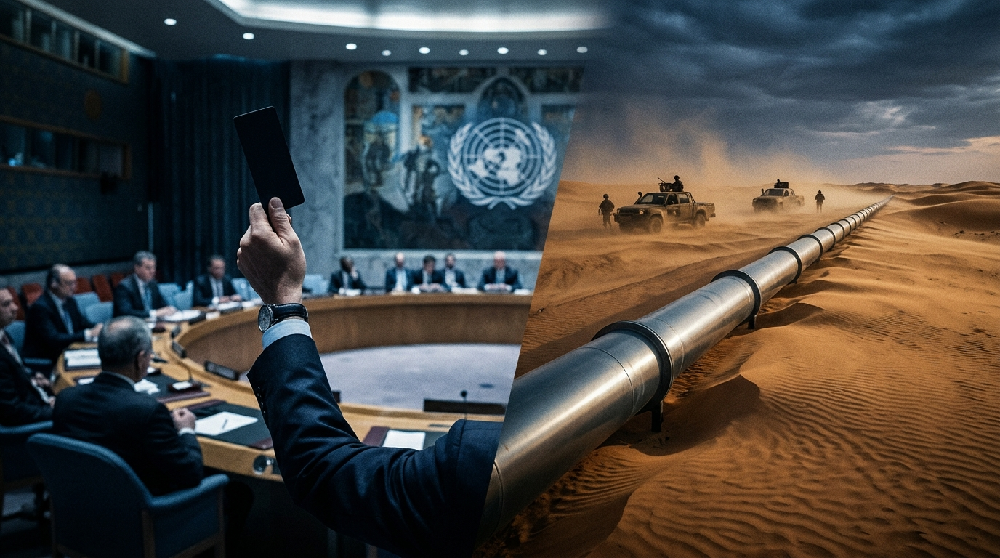

Par la rédaction d'Afrique Décrypte

À Alger, la presse officielle et les relais de la nomenklatura célèbrent à grand renfort d'éditoriaux enflammés une « victoire historique du non-alignement ». Le vendredi 30 octobre 2026, dans la salle feutrée du Conseil de sécurité des Nations unies à New York, la Fédération de Russie a opposé un veto tranchant au projet de résolution américain qui consacrait, pour la première fois de manière explicite et exclusive, le plan d'autonomie marocain comme unique base de règlement du dossier du Sahara occidental. Pour la diplomatie algérienne, le soulagement immédiat est à la hauteur de la panique qui l'étreignait depuis des mois : le Front Polisario, sa créature cinquantenaire en décomposition, s'offre un sursis artificiel de quelques trimestres.

Mais les relations internationales ne se jugent pas aux cris de soulagement des diplomaties assiégées : elles s'évaluent au grand livre des comptes stratégiques. Et à ce jeu d'échecs impitoyable, la vérité que dissimule le vacarme médiatique algérien est d'une brutalité chirurgicale : **le veto de Moscou n'est en rien une marque de solidarité fraternelle ; c'est le reçu officiel d'une capitulation géopolitique en règle.**

Pour obtenir ce bras levé de l'ambassadeur russe à New York, le régime d'Alger a dû payer une rançon exorbitante : renier soixante ans de posture tiers-mondiste, trahir sans scrupules ses alliés historiques touareg au Sahel, se coucher devant les exigences militaires de l'Africa Corps russe au Mali et au Niger, et jeter ses derniers milliards de pétrodollars dans le sauvetage à bout de bras des juntes putschistes sahéliennes. 

Pendant que les chancelleries occidentales s'égarent dans leurs sempiternelles lamentations sur le « blocage du droit international », Savinien de Montagnac pose ici l'armature clinique des faits : pris au piège d'une économie rentière en voie d'épuisement rapide et d'une dépendance militaire absolue envers le Kremlin, l'État algérien est devenu l'otage consentant d'une diplomatie d'acier qui le dépouille de sa profondeur stratégique tout en le précipitant vers la banqueroute.

    <figure>
        
        <figcaption>30 Octobre 2026 : Le Conseil de sécurité de l'ONU et le grand marchandage géopolitique entre Moscou et Alger sur le Sahara et le Sahel</figcaption>
    </figure>

---

### 1. La méthode Lavrov : Anatomie d'une soumission en deux actes

Pour mesurer le gouffre qui sépare l'illusion propagandiste d'Alger de la réalité du rapport de force, il suffit d'un simple coup d'œil dans le rétroviseur diplomatique.

Il y a un an jour pour jour, le 31 octobre 2025, sur cette même question du Sahara occidental, lors du vote de la résolution 2797 du Conseil de sécurité, la Russie s'était abstenue. Elle n'avait pas levé le petit doigt pour stopper l'avancée inexorable de la doctrine marocaine, laissant son allié historique algérien dans une solitude cuisante et une humiliation publique totale. Que s'est-il donc passé en l'espace de douze mois pour que Moscou effectue un revirement à 180 degrés et dégaine son veto protecteur au bénéfice d'Alger ?

La réponse tient en un mot : **le dressage**.

Depuis plusieurs années, grisée par les cours élevés du gaz consécutifs au conflit ukrainien, la diplomatie algérienne s'était mise à rêver d'une grandeur factice. Alger prétendait dicter ses conditions, jouer sur les rivalités entre l'Occident et l'Orient, tout en menant au Sahel une politique diamétralement opposée aux intérêts stratégiques russes. Alors que Moscou déployait ses forces spéciales et ses supplétifs d'Africa Corps pour écraser les mouvements rebelles du Nord-Mali aux côtés de la junte bambara de Bamako, Alger continuait en sous-main de protéger, financer et soigner les chefs indépendantistes touareg et arabes de l'Azawad (réunis au sein du CSP-DPA). Alger s'imaginait pouvoir maintenir indéfiniment son statut d'arbitre incontournable du Sahara tout en achetant pour plus de 80 % de son arsenal militaire sophistiqué (chasseurs Sukhoi, batteries S-400, sous-marins Kilo) auprès des usines russes.

Cet orfèvre du cynisme géopolitique qu'est Sergueï Lavrov, ministre russe des Affaires étrangères, a méthodiquement brisé cette illusion en administrant à Alger deux électrochocs successifs :

1. **L'exclusion brutale des BRICS** : En août 2023 à Johannesburg, puis lors des sommets de confirmation en 2024 et 2025, Moscou a opposé une fin de non-recevoir glaciale à la candidature algérienne. Lavrov a publiquement humilié le président Abdelmadjid Tebboune en rappelant que l'appartenance au bloc exigeait une économie productive diversifiée et une « stricte convergence de vues stratégiques ». Le message était limpide : Alger ne pèse rien sur le plan économique et ses velléités d'autonomie diplomatique ne sont plus tolérées.
2. **Le lâchage onusien du 31 octobre 2025** : En refusant d'opposer son veto à la résolution 2797, la Russie a signifié sans détours à la junte d'Alger que si elle persistait à entraver l'offensive russe au Sahel en sanctuarisant les Touareg, Moscou laisserait Washington et Paris acter la souveraineté définitive du Maroc sur les provinces du Sud.

Face à cet ultimatum existentiel, le régime algérien n'a pas résisté bien longtemps. La capitulation a été intégrale : Alger a promptement fermé sa frontière sud, coupé les vivres et l'approvisionnement médical aux insurgés de l'Azawad, et applaudi sans broncher à la progression des colonnes conjointes des FAMA et de l'Africa Corps à Kidal, Tin Zaouatine et dans l'Adrar des Ifoghas. Pour sceller définitivement sa rentrée dans le rang, Alger a dépêché ses émissaires à Niamey pour voler au secours financier et logistique du général Abdourahamane Tiani — l'homme lige de Moscou au Niger —, en lui livrant des hélicoptères de combat, du kérosène à prix bradé et une assistance électrique d'urgence.

Le veto russe du 30 octobre 2026 n'est donc rien d'autre que la récompense octroyée par le maître d'échecs moscovite à un vassal qui a exécuté sans ciller sa part du contrat.

---

### 2. Le Réalisme Ethno-Historique : Pourquoi la trahison des Touareg est une faute mortelle

En sacrifiant l'alliance séculaire avec les tribus nomades du désert au profit d'un alignement servile sur l'axe russe et les juntes militaires sédentaires du Sud, le pouvoir algérien a commis une faute géopolitique impardonnable dont les conséquences à moyen terme seront dévastatrices.

L'histoire longue du Sahara, que les idéologues marxisants d'Alger ont toujours voulu effacer au profit d'un narratif jacobin hérité de l'administration coloniale française, repose sur une ligne de fracture anthropologique fondamentale : **l'incompatibilité structurelle entre le monde nomade pastoral blanc (Touareg, Maures) et le monde sédentaire noir d'Afrique subsaharienne (Bambaras, Haoussas, Songhaïs, Zarmas).**

Depuis l'indépendance artificielle du Mali et du Niger dans les années 1960, les frontières issues du tracé colonial ont enfermé les hommes libres du désert dans des États dirigés depuis les capitales du Sud par des bureaucraties sédentaires qui les méprisent et les pillent. Chaque fois que les rébellions touareg ont éclaté (1963, 1990, 2006, 2012), l'Algérie avait su jouer le rôle d'amortisseur et de garant territorial. En accordant l'asile aux chefs de clans, en canalisant les rivalités entre les Ifoghas, les Idnan et les Chamanamas, et en tolérant les réseaux de contrebande transfrontaliers traditionnels, Alger sanctuarisait son propre flanc sud et évitait toute contamination autonomiste chez ses propres populations touareg du Hoggar et du Tassili n'Ajjer.

En rompant unilatéralement ce pacte ancestral, Alger a commis une triple erreur de calcul :

* **Elle a détruit son statut d'arbitre régional** : Aucun chef de tribu nomade, aucun chef de faction au Sahel ne croira plus jamais la moindre parole émanant d'Alger. Le régime s'est révélé pour ce qu'il est : une puissance perfide, prête à sacrifier ses frères de sang pour un marchandage de couloir à New York.
* **Elle ouvre un boulevard géopolitique à Rabat et à Haftar** : Privées de leur parrain algérien, les élites touareg et arabes de l'espace saharo-sahélien se tournent déjà vers de nouveaux protecteurs. Le Maroc, fort de son initiative royale pour l'accès des pays sahéliens à l'Atlantique, et le maréchal Khalifa Haftar, maître du Fezzan libyen, étendent leurs réseaux d'influence au cœur même de l'ancien pré carré algérien.
* **Elle s'expose à une déstabilisation intérieure majeure** : La frontière entre le Mali et l'Algérie n'existe que sur le papier d'état-major. Les Kel Adagh de Kidal sont les cousins directs des Kel Ahaggar de Tamanrasset. En livrant les premiers aux massacres et aux exactions de l'Africa Corps russe et des milices de Bamako, le pouvoir militaire d'Alger suscite une rancœur incandescente chez ses propres citoyens du Sud, qui voient s'effondrer la dernière illusion d'une solidarité saharienne.

---

### 3. Autopsie de l'École Autrichienne : 55 % de dépenses parasitaires et la mort annoncée de la rente

Pourquoi un régime réputé si jaloux de sa souveraineté a-t-il capitulé avec une telle docilité devant les exigences de Moscou ? 

Pour le comprendre, il ne faut pas interroger les diplomates : il faut ouvrir les livres de comptes de la Sonatrach et du Trésor public algérien sous la lumière impitoyable de l'École autrichienne d'économie (Ludwig von Mises, Frédéric Bastiat).

L'Algérie contemporaine est le prototype absolu de l'**État de spoliation légale**. Ne produisant quasiment rien en dehors de ses hydrocarbures (qui représentent plus de 95 % de ses recettes d'exportation et alimentent 99 % de son électricité nationale), le régime n'assure sa survie politique que par la redistribution massive d'une rente extractive confisquée par une nomenklatura politico-militaire.

Or, les chiffres officiels récents et les projections du FMI révèlent une trajectoire d'effondrement budgétaire inéluctable :

| Poste Budgétaire Clé | Réalité 2025 / 2026 | Analyse Économique Clinique |
| :--- | :--- | :--- |
| **Subventions sociales & transferts** | **46,3 Mds USD** (34,1 % du budget global) | Achat forcé de la paix sociale (pain, lait, carburant, allocations chômage, retraites déficitaires) sans aucune contrepartie productive. |
| **Budget de la Défense (ANP)** | **25,0 Mds USD** (18,4 % du budget global) | Budget militaire le plus colossal d'Afrique, ayant quasiment triplé en 4 ans (9,1 Mds USD en 2022). Dépense stérile en matériel russe d'importation. |
| **Poids des dépenses improductives** | **52,5 % à 55 % du budget d'État** | Plus de la moitié des richesses nationales est engloutie dans l'armement et le clientélisme social, stérilisant tout investissement créateur de valeur. |
| **Réserves de change nettes** | 51 Mds USD (2025) ➔ **46,5 Mds USD (2026)** | Chute continue du matelas financier. Projection officielle du FMI : **19,8 Mds USD d'ici 2031**. |
| **Production gazière mature** | Déclin naturel de Hassi R'Mel et Hassi Messaoud | Consommation intérieure en hausse explosive (+4 % par an) rognant drastiquement les surplus exportables vers l'Union européenne. |

Comme l'enseignait Frédéric Bastiat dans *La Loi*, lorsque l'État s'érige en machine géante à prélever la rente pour acheter la soumission d'une population maintenue dans l'assistanat, il condamne le pays à une paupérisation foudroyante dès que la rente tarit. En Algérie, le modèle arrive en bout de course. Malgré des investissements d'urgence de 50 à 60 milliards de dollars injectés par Sonatrach pour enrayer le déclin naturel des gisements gaziers historiques d'Hassi R'Mel et d'In Amenas, le pays est incapable d'augmenter durablement ses exportations vers l'Europe, car l'explosion de sa consommation domestique absorbe désormais plus de la moitié de sa production.

C'est ici qu'intervient l'obsession existentielle du régime Tebboune pour le **Gazoduc Transsaharien (TSGP)**, ce projet pharaonique de 4 128 kilomètres censé acheminer 30 milliards de mètres cubes de gaz nigérian à travers le Niger jusqu'aux terminaux gaziers algériens de la Méditerranée.

Pour Alger, le TSGP n'est pas un projet d'infrastructure marchand : c'est une perfusion vitale. Si ce gazoduc ne voit pas le jour, l'Algérie perdra d'ici 2030 son statut de fournisseur énergétique stratégique de l'Europe, ses réserves de change s'effondreront sous la barre critique des 20 milliards de dollars, et le régime n'aura plus les moyens de financer les 46 milliards de subventions annuelles indispensables pour empêcher une nouvelle explosion sociale type Hirak.

Voilà la clé de voûte de la capitulation d'Alger : pour tenter de sauver le TSGP face au projet concurrent maroco-nigérian (NMGP) qui longe les côtes atlantiques, l'Algérie devait impérativement sécuriser le tronçon nigérien contrôlé par la junte d'Abdourahamane Tiani. Et pour amadouer Tiani, il fallait obéir aux ordres de son tuteur exclusif à Moscou.

Mais cette manœuvre économique est une chimère absolue. Bâtir un gazoduc pressurisé de 13 milliards de dollars à travers 4 000 kilomètres de désert hostile, tout en ayant trahi et dressé contre soi les tribus touareg et tubu qui contrôlent les routes et les puits, relève de l'aveuglement constructiviste le plus total. Le premier coup de pelleteuse sera le signal d'un sabotage permanent par des populations nomades spoliées qui n'ont désormais plus rien à perdre.

---

### 4. La Chute Stratégique : L'Algérie dans la nasse de ses propres mensonges

Le vote du 30 octobre 2026 à New York fera date, mais pas pour les raisons qu'imaginent les thuriféraires du pouvoir algérien.

Ce veto russe marque le chant du cygne de la diplomatie algérienne du XXe siècle. En voulant sauver à tout prix sa fiction du Polisario au Sahara occidental, Alger a sacrifié sa profondeur stratégique au Sahel, aliéné pour des générations les peuples du désert, et transformé son armée en simple cliente vassalisée d'un complexe militaro-industriel russe qui lui dicte désormais sa politique étrangère.

Pendant ce temps, à Rabat, l'analyse froide prévaut. La diplomatie marocaine sait parfaitement que le temps travaille pour elle. Le plan d'autonomie marocain bénéficie déjà du soutien explicite des États-Unis, de la France, de l'Espagne, de l'Allemagne et de la quasi-totalité des capitales influentes du continent africain. Le veto de Moscou n'est qu'un baroud d'honneur dilatoire, un péage prélevé par Lavrov pour acter la soumission algérienne au Sahel.

Sur le plan économique, la spoliation étatique algérienne a atteint ses limites physiques. Un pays qui consacre plus de la moitié de son budget à acheter des blindés russes et du blé d'importation pour nourrir une population privée d'initiatives de marché ne peut pas tenir face à une économie productive intégrée aux chaînes de valeur mondiales.

L'Algérie a cru acheter une victoire diplomatique à l'ONU : elle n'a fait que signer l'acte notarié de sa propre mise sous tutelle géopolitique. Les sables du Sahara et les lois d'airain de l'économie autrichienne se chargeront très bientôt de présenter la facture finale.

---

*Signé : Savinien de Montagnac*  
*Pour la rédaction d'Afrique Décrypte*
