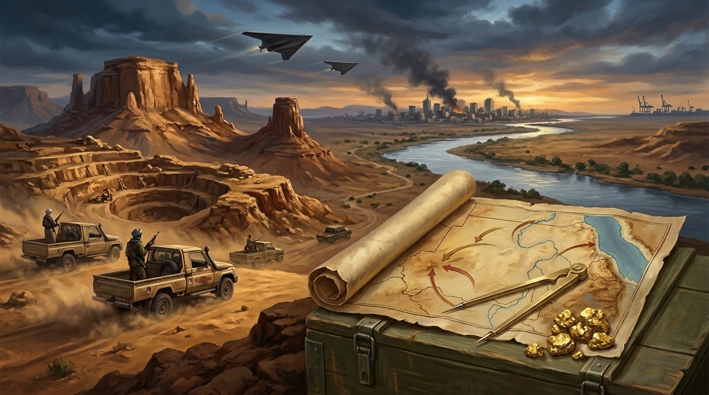

Par la rédaction d'Afrique Décrypte

Le dimanche 22 novembre 2026, alors que les drones kamikazes frappaient les quartiers résidentiels d'Omdurman et endommageaient un complexe des Nations unies à Khartoum, les chancelleries occidentales ont dégainé leur lexique habituel de déploration morale. À New York, à Bruxelles et à Genève, le même refrain lénifiant tourne en boucle depuis avril 2023 : le Soudan subirait une « lutte insensée pour le pouvoir entre deux généraux ambitieux », aggravée par le « dérèglement climatique » et un « déficit de médiation inclusive ».

Cette grille de lecture est une imposture intellectuelle. Elle explique pourquoi la diplomatie onusienne accumule les conférences avortées pendant que s'enfonce la plus vaste tragédie humaine du continent — une guerre où, selon le Haut-Commissariat de l'ONU aux droits de l'homme en novembre 2026, plus de **1 630 civils sur 2 230 victimes recensées entre janvier et octobre** ont péri sous les frappes de drones.

Ce qui se joue entre les décombres de Khartoum, les charniers d'El-Fasher, les mines d'or du Darfour et les bases dénoncées jusqu'en Éthiopie n'est ni un malentendu constitutionnel ni un duel d'egos. C'est l'implosion mécanique d'une **triple fiction** : une **fiction ethno-territoriale** forgée au XIXe siècle par la conquête égyptienne puis britannique ; une **fiction médiatique** masquant un affrontement ethno-racial séculaire au sein d'un islam partagé ; et une **fiction économique** ouverte en 2011 quand la sécession du Sud priva Khartoum des trois quarts de sa rente pétrolière, transformant l'État en cartel de spoliation autour de l'or du Darfour.

Savinien de Montagnac livre l'autopsie clinique d'un pays qui meurt de l'agonie violente de l'État-fiction lui-même.

    <figure>
        
        <figcaption>Novembre 2026 : Entre mines d'or du Darfour, frappes de drones sur Khartoum et convoitises sur Port-Soudan — Autopsie ethno-historique et économique de la déflagration soudanaise</figcaption>
    </figure>

---

### 1. L'État-Fiction du Nil : Un Assemblage Impérial Forgé par la Razzia et la Conquête

Pour comprendre pourquoi le Soudan se disloque dès que la contrainte centrale se fissure, il faut d'abord balayer le dogme postcolonial de « l'unité nationale soudanaise ». L'État soudanais n'a jamais été une nation organique : il est le produit artificiel d'un double impérialisme, turco-égyptien puis anglo-égyptien.

Avant le XIXe siècle, trois ensembles hétérogènes s'ignoraient ou s'affrontaient le long du Nil :
- **La Nubie**, héritière des royaumes nubiens christianisés puis islamisés, dominée jusqu'en 1820 par le sultanat Funj de Sennar ;
- **Le Darfour** à l'Ouest — littéralement le *« Pays des Fur »* —, plateau de 500 000 km² où un sultanat négro-africain musulman prospérait autour du Djebel Mara dès le début du XVIIe siècle ;
- **Le Sud luxuriant** du Bahr el-Ghazal et de l'Equatoria, peuplé d'ethnies nilotiques (Dinka, Nuer, Shilluk) protégées par les marais du Sudd.

En **1820-1821**, Méhémet Ali d'Égypte conquiert la Nubie pour l'ivoire, l'or et les esclaves. En 1822, la Nubie se soulève et son fils Ismaël périt brûlé vif, avant que la répression n'aboutisse en **1830** à la fondation de **Khartoum** comme poste avancé du Nord. En **1874**, le gouverneur Ziber Pacha annexe le sultanat du Darfour pour le khédive, soudant de force au Nil un Ouest qui ne lui avait jamais appartenu.

La réaction contre cette tutelle — aggravée par la nomination de gouverneurs européens « infidèles » (Samuel Baker, Charles Gordon) — déclenche de **1881 à 1898** l'insurrection théocratique du **Mahdi**, portée par les nomades de l'Ouest contre les sédentaires pro-égyptiens de la confrérie *Khatmiya*. Écrasé par Kitchener à **Omdurman en 1898**, l'État mahdiste cède la place au condominium anglo-égyptien.

Les Britanniques reconnurent longtemps l'autonomie du Darfour jusqu'en **1916**, année où le gouverneur général Wingate soumit le sultan Ali Dinar — tenté par un rapprochement avec les Turcs en Libye — grâce à des **cavaleries arabes du Nord**, ancêtres directs des *Janjawid*. Au Sud, Londres tenta tardivement de préserver les peuples nilotiques via sa *Southern Policy*, envisageant leur rattachement à l'Ouganda. Le refus de cette partition en 1956 condamna le Soudan à cinquante-cinq ans de guerre raciale et religieuse jusqu'au référendum de janvier 2011, où **98 % des Sud-Soudanais** votèrent la sécession.

---

### 2. La Fracture que l'Occident Refuse de Nommer : Arabes Nomades contre Négro-Africains en Terre d'Islam

Depuis le déclenchement de l'actuelle guerre civile le **15 avril 2023** entre l'armée régulière du général **Abdel Fattah al-Burhane** (SAF) et les Forces de soutien rapide (FSR) de **Mohamed Hamdane Daglo**, dit **« Hemedti »**, les commentateurs occidentaux éprouvent un malaise évident. Habitués lors des guerres sud-soudanaises à plaquer la grille confortable « Nord musulman contre Sud chrétien », ils se retrouvent démunis au Nord et au Darfour pour une raison élémentaire : **tous les belligérants y sont musulmans**.

Leur réflexe consiste donc à nier l'ethno-histoire pour réduire l'incendie à une querelle de généraux. Or, l'autopsie conduite par Savinien de Montagnac révèle l'imbrication de deux affrontements séculaires que la guerre des drones rend seulement plus meurtriers :

1. **Les riverains nubiens du Nil contre les Bédouins des steppes de l'Ouest** :
   L'ossature de l'État et des officiers d'al-Burhane repose sur les **Nubiens arabisés du Nil** — région qui abrite plus de 60 % de la population du Nord et prolonge l'héritage des élites sédentaires de la *Khatmiya*. En face, les FSR d'Hemedti recrutent au sein des **tribus bédouines nomades « arabes »** de l'Ouest et de la bande tchado-soudanaise. L'ethnologie y distingue deux lignées : les *Hassana*, venus de Libye par les pistes garamantes, et les *Djohana* (*El Djuzm*, *El Fezara*, *Homs*), arrivés d'Arabie par le Nil. Hemedti lui-même est issu des **Rizeigat**, matrice des *Janjawid* (« hommes à cheval »), ces cavaliers militarisés par Khartoum dès 2003.

2. **Le choc ethno-racial au Darfour et la fragilité de la mer Rouge** :
   Dans l'Ouest, les nomades qui se revendiquent « Arabes » et « Blancs » affrontent les **15 peuples négro-africains sédentaires** du Darfour — d'abord les **Fur** du Djebel Mara, les **Massalit** (à cheval sur le Tchad), les **Zaghawa** (liés au clan Déby à N'Djamena) et les **Berti**.

Les massacres qui ont suivi la chute d'**El-Fasher**, capitale du sultanat du Darfour prise par les FSR entre le **26 octobre et le 4 novembre 2025** après dix-huit mois de siège — qualifiés en février 2026 par les enquêteurs de l'ONU de porteurs des « caractéristiques d'un génocide » —, prolongent directement la guerre de 2003 (300 000 morts) et l'expédition de 1916. Et à l'Est, **Port-Soudan**, ultime réduit d'al-Burhane sur la mer Rouge, dépend de la loyauté précaire des **Bedja**, qui ont souvent bloqué la voie ferrée vers le Nil.

---

### 3. L'Autopsie Autrichienne : De la Faillite Pétrolière à la Spoliation Légale par l'Or

Si l'ethno-histoire trace les lignes de fracture, seule la praxéologie de **l'École autrichienne d'économie** (Ludwig von Mises, Friedrich Hayek, Frédéric Bastiat) et la morale productiviste d'**Ayn Rand** expliquent comment l'État soudanais a muté en machine d'autodestruction industrielle.

Tout bascule en **2011** sur le terrain de la rente. Avant la partition du Sud, le Soudan produisait **470 000 barils de pétrole par jour**, dont **les trois quarts (350 000 b/j)** dans le Sud. Quand le Soudan du Sud devient indépendant — puis ferme ses puits frontaliers en janvier 2012 lors de la crise d'Heglig et d'Abyei pour briser les droits de transit exigés par Khartoum —, l'État soudanais perd brutalement **75 % de ses recettes pétrolières**.

Incapable de réformer une économie étouffée par les monopoles militaires et les subventions clientélistes, le régime d'Omar el-Béchir s'enfonce dans la dette et l'inflation. En avril 2019, le **triplement du prix du pain** déclenche la révolte : l'armée écarte Béchir, installe al-Burhane au Conseil de souveraineté, puis s'empare du pouvoir lors du coup d'État du **25 octobre 2021** avec l'appui féroce des FSR.

Comment Hemedti, simple chef de milice cavalière, est-il devenu assez riche pour défier l'armée régulière le 15 avril 2023 ? Par ce que Frédéric Bastiat nommait la **spoliation légale**.

Privé de pétrole après 2011, Omar el-Béchir avait acheté sa garde prétorienne en autorisant les FSR à **« se payer sur la bête »** : contrôle armé des mines d'or, à commencer par **Jebel Amer** au Darfour. Au lieu de sécuriser des droits de propriété privés et un ordre catallactique, Khartoum a forgé un **monopole paramilitaire prédateur** doté de sa propre trésorerie aurifère hors banque centrale. Quand al-Burhane exigea en avril 2023 la dissolution des FSR dans l'armée, il sommait le cartel bédouin de rendre son or. La guerre éclata sur-le-champ.

Depuis trois ans, le conflit fonctionne comme un **capitalisme de connivence armé** qui écrase tous les producteurs réels du pays :

| Pôle de Prédation | Base Économique & Parrains Extérieurs | Mécanisme de Spoliation | Impact Économique (École Autrichienne) |
| :--- | :--- | :--- | :--- |
| **Axe FSR (Hemedti) — Darfour / Kordofan** | Or pillé à **Jebel Amer** et dans l'Ouest, bétail razzié, contrebande via Tchad et Libye ; écoulement et armement via les **Émirats arabes unis (Dubaï)**, pas de tir de drones dénoncés jusqu'en **Éthiopie**. | Confiscation armée des mines, extorsion sur les pistes sahariennes, pillage des récoltes et des marchés urbains. | Conversion directe de l'or en **drones kamikazes** ; destruction intégrale du capital agricole du Darfour et du Kordofan. |
| **Axe SAF (al-Burhane) — Vallée du Nil / Port-Soudan** | Rente portuaire et douanière de **Port-Soudan**, appui de **l'Égypte**, drones fournis par **l'Iran**, coopération militaire avec la **Russie** et la Turquie. | Monétisation du déficit, hyperinflation, réquisitions militaires et racket aux barrages routiers. | Ruine des négociants d'Omdurman et des paysans irrigués de la **Jézira** ; fuite des compétences, rupture des échanges et famine artificielle. |

Entre ces deux appareils parasitaires, c'est **le producteur réel** — l'agriculteur Fur du Djebel Mara, le paysan des terres irriguées de la Jézira entre Nil Bleu et Nil Blanc, le commerçant d'Omdurman — qui paie le prix du sang. Sous les bombes comme sous l'extorsion, la propriété privée a cédé la place au pur droit du fusil.

---

### 4. La Chute Stratégique : Guerre des Drones, Front Éthiopien et Partition de Fait

En cette fin novembre 2026, l'illusoire unité du Soudan achève de se consumer dans une **régionalisation ouverte vers la Corne de l'Afrique et la mer Rouge**.

En saisissant formellement le Conseil de sécurité de l'ONU et l'Union africaine contre l'**Éthiopie d'Abiy Ahmed** — accusée par Khartoum de laisser les FSR soutenues par les Émirats utiliser les sites de **Bahir Dar** et d'**Asosa** comme bases de lancement de drones vers la capitale soudanaise et l'État du Nil Bleu —, al-Burhane confirme ce que Savinien de Montagnac démontrait dès l'origine : les frontières postcoloniales de la bande sahélo-nilotique sont caduques.

La guerre civile soudanaise dessine déjà une partition de fait :
- **À l'Ouest**, le Darfour et des pans du Kordofan aux mains des FSR forment un proto-émirat bédouin-aurifère connecté au Tchad instable, à la Libye divisée et aux réseaux financiers du Golfe.
- **À l'Est**, le réduit nilotique et portuaire de Port-Soudan ne survit que sous perfusion du Caire, de Téhéran et d'une Russie qui n'a jamais oublié l'accord naval signé secrètement avec Omar el-Béchir en 2018 sur la mer Rouge.
- **Au Sud-Est**, l'arc de crise soudanais fusionne avec la décomposition fédérale de l'Éthiopie et la bataille pour les détroits de la mer Rouge.

À Khartoum, les débris du bâtiment onusien touché le 22 novembre 2026 signent la faillite définitive du constructivisme diplomatique occidental. Aucun sommet à Genève ni aucun chèque humanitaire ne recollera les morceaux d'un empire artificiel privé de sa rente pétrolière et déchiré entre peuples irréductibles. Au Soudan comme partout ailleurs en Afrique, les temps longs de l'ethno-histoire et les lois d'airain de l'économie réelle survivent toujours aux fictions juridiques tracées sur le sable.

---

*Signé : Savinien de Montagnac*  
*Pour la rédaction d'Afrique Décrypte*
